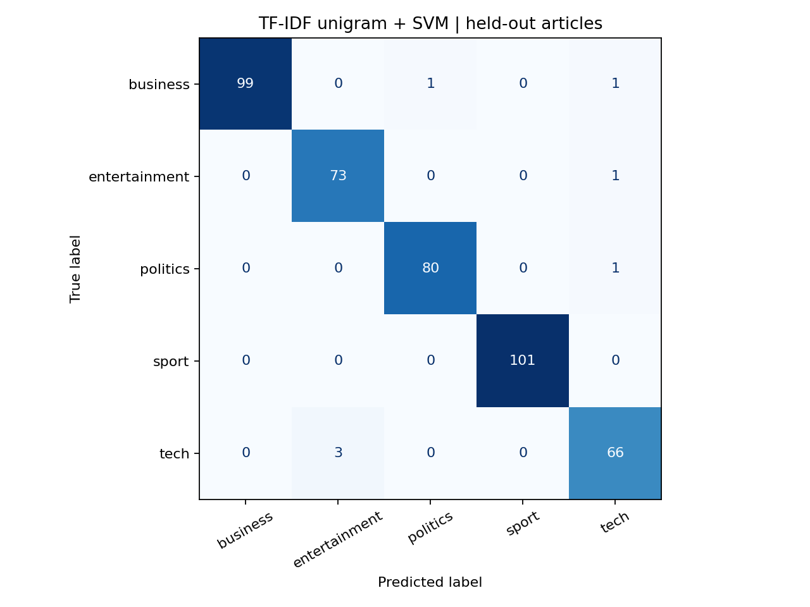

# BBC News · NLP Classification

**A reproducible benchmark for classifying news into business, entertainment, politics, sport and technology.**

  

**En français :** comparaison de représentations textuelles et de classifieurs SVM/KNN sur cinq catégories d’actualité. Le nouveau benchmark apprend les représentations sur l’entraînement uniquement et conserve les résultats historiques à part.

[Results](#results) · [Quick start](#quick-start) · [Data setup](data/README.md) · [Methodology](docs/methodology.md) · [Related work](docs/related-projects.md)



## What this demonstrates

- Corpus inspection, exact deduplication and reproducible stratified evaluation.
- Sparse TF-IDF baselines versus optional dense Word2Vec and MiniLM representations.
- Accuracy, macro F1, weighted F1 and a readable confusion matrix.
- Separation of historical exploration from the corrected executable workflow.

## Results

Verified on the supplied BBC corpus: **2,127 unique documents**, including **426 held-out articles**.

| Representation | Classifier | Accuracy | Macro F1 |
|---|---|---:|---:|
| TF-IDF unigrams | SVM | 98.36% | 98.15% |
| TF-IDF unigrams | KNN | 93.66% | 93.50% |
| TF-IDF uni + bigrams | SVM | 97.89% | 97.64% |
| TF-IDF uni + bigrams | KNN | 94.60% | 94.34% |

[Metrics and run manifest](reports/validated) record the verified baseline. Optional embedding models are implemented but were not rerun in this environment. The original eight-model comparison is retained in [historical_metrics.csv](reports/historical_metrics.csv), with its methodological limitations explained in [research/README.md](research/README.md).

## Quick start

Requires Python 3.11+. First place the original corpus under `data/bbc/` as described in the [data guide](data/README.md).

```bash
python -m venv .venv
# macOS / Linux
source .venv/bin/activate
# Windows PowerShell: .venv\Scripts\Activate.ps1
python -m pip install -r requirements.txt
python src/benchmark.py
```

Optional dense representations:

```bash
python -m pip install -r requirements-embeddings.txt
python src/benchmark.py --embeddings
```

The optional run downloads `sentence-transformers/all-MiniLM-L6-v2` on first use. All results are written to `reports/current/`; pretrained models and article text are not committed.

## Repository guide

| Path | Purpose |
|---|---|
| `src/benchmark.py` | Current benchmark with training-only feature fitting |
| `research/` | Six original academic scripts and interpretation notes |
| `reports/validated/` | New baseline metrics and confusion matrix |
| `reports/historical_metrics.csv` | Original exploratory comparison |
| `data/README.md` | Corpus provenance and local setup |
| `docs/methodology.md` | Evaluation protocol and limitations |

[Authorship and preparation](AUTHORS.md) · [Reuse notice](NOTICE.md)
